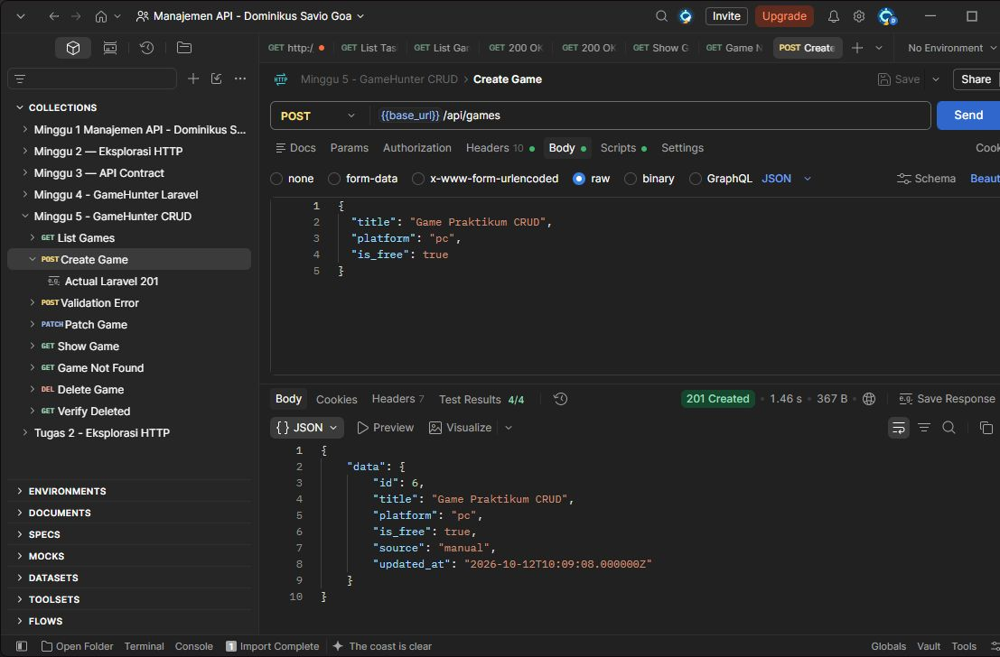
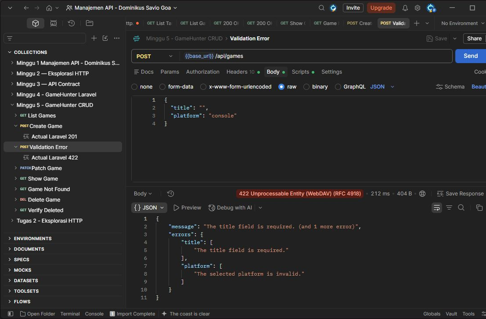
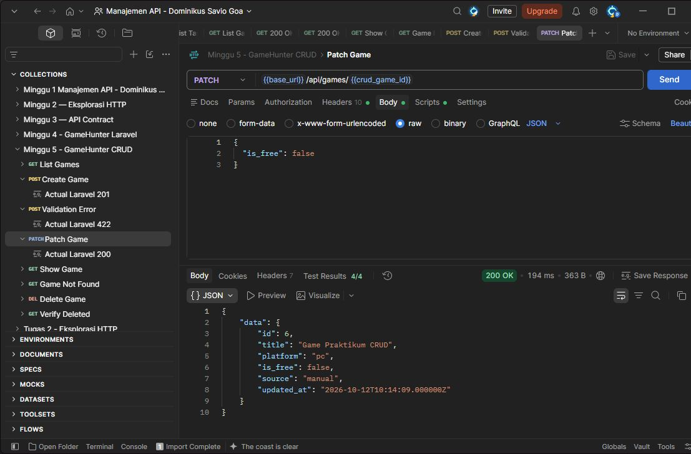
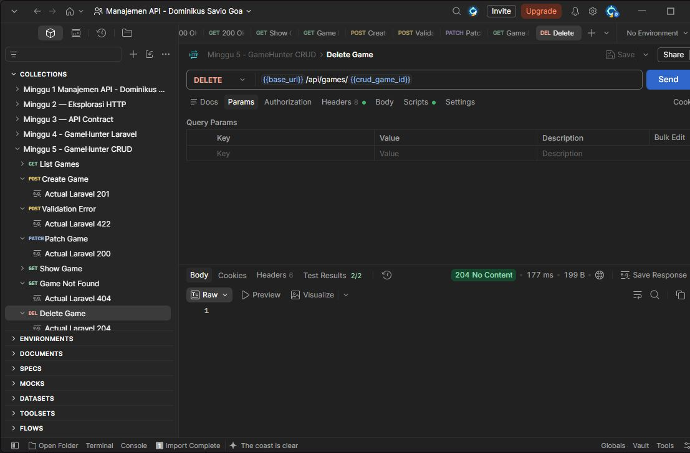

# Praktikum Minggu 5 — CRUD GameHunter

## Tujuan dan perubahan

Saya melanjutkan API GameHunter menjadi CRUD. StoreGameRequest dan UpdateGameRequest memeriksa input. GameResource menjaga bentuk JSON tetap konsisten.

## Endpoint

| Method | Endpoint | Hasil |
| --- | --- | --- |
| GET | /api/games | 200, daftar game |
| POST | /api/games | 201, game dibuat |
| GET | /api/games/{id} | 200, detail game |
| PUT/PATCH | /api/games/{id} | 200, game diperbarui |
| DELETE | /api/games/{id} | 204, tanpa body |

Gunakan `Accept: application/json`, `Content-Type: application/json`, dan No Auth.

## Validasi

Create membutuhkan title 3–200 karakter dan platform pc/browser. is_free opsional, default false. Update hanya memvalidasi field yang dikirim. ID, source, dan timestamps ditentukan server.

## Bukti pengujian

Diuji pada 12 Oktober 2026. **41 test Game, 132 assertion lulus**. Seluruh suite Pest: **43 test, 134 assertion lulus**.

| Pengujian | Hasil aktual |
| --- | --- |
| GET daftar | 200, array data |
| POST game valid | 201, game baru dengan source manual |
| POST title kosong dan platform console | 422, errors.title dan errors.platform |
| PATCH is_free: false | 200, title dan platform tetap |
| GET detail | 200, perubahan tersimpan |
| GET ID 999999 | 404, Resource not found |
| DELETE game yang dibuat | 204, body kosong |
| GET ulang ID yang dihapus | 404 |

Foto berikut diambil setelah request dikirim lewat Postman. Kursor dan sorot biru berada di luar gambar. ID dan waktu dapat berbeda dari contoh karena request dijalankan ulang.

Create — 201 Created, 4/4 test lulus.



Title kosong dan platform console — 422.



PATCH is_free menjadi false — 200, 4/4 test lulus.



Game tidak ditemukan — 404, 3/3 test lulus.


DELETE — 204, body kosong, 2/2 test lulus.



Screenshot menunjukkan hasil create, validasi, update, data tidak ditemukan, dan delete.

## Bentuk response

Response sukses memakai wrapper `data`. Create menghasilkan 201, update 200, dan delete 204 tanpa body. Error 404 berisi `{"message":"Resource not found","errors":null}`. Validasi gagal menghasilkan 422 dengan `message` dan `errors`.

## Menjalankan ulang

Kode Laravel berada di project lokal `projek_api`. Repository ini berisi dokumentasi dan screenshot. Dari folder project lokal:

```bash
php artisan serve --host=127.0.0.1 --port=8000
```

Di Postman, gunakan URL dasar `http://127.0.0.1:8000`. Kirim POST dengan body JSON berikut:

```json
{"title":"Game Praktikum CRUD","platform":"pc","is_free":true}
```

Catat ID dari response. Gunakan ID itu untuk GET, PATCH, dan DELETE. Untuk PATCH, kirim `{"is_free":false}`. Coba POST dengan title kosong dan platform console untuk melihat 422. GET `/api/games/999999` menghasilkan 404.

Pada terminal kedua:

```bash
php artisan test --compact tests/Feature/GameCrudTest.php tests/Feature/GameReadOnlyTest.php
```

## Kesimpulan

CRUD GameHunter sudah berjalan. Validasi, update sebagian, dan penghapusan telah diuji. Pengujian memakai data lokal tanpa credential atau secret.

## Referensi

- Praktikum 5 — Membangun CRUD yang Konsisten, materi kelas; disesuaikan ke GameHunter.
- [Laravel Validation](https://laravel.com/framework/docs/13.x/validation), [API Resources](https://laravel.com/framework/docs/13.x/eloquent-resources), dan [Controllers](https://laravel.com/framework/docs/13.x/controllers).

## Deklarasi penggunaan AI

AI membantu saya dalam praktikum dan langkah pengerjaan saat ada kendala.
